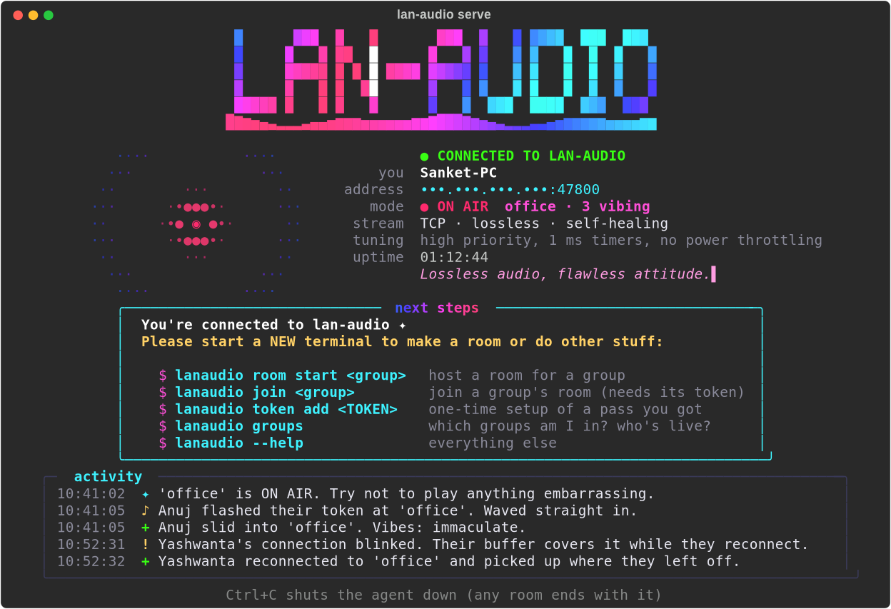
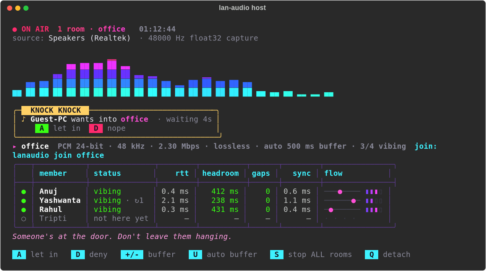
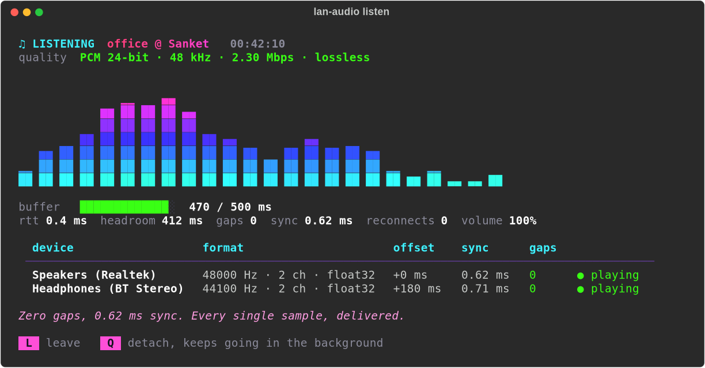
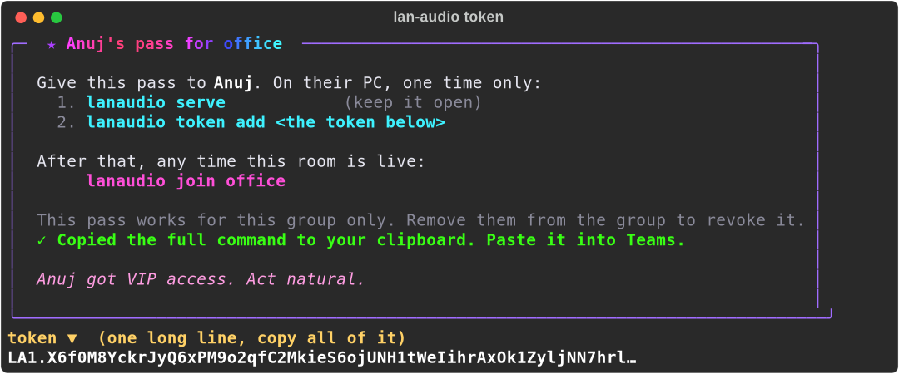
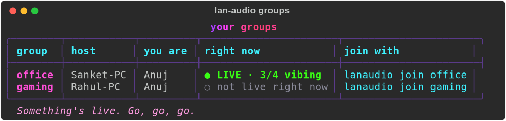
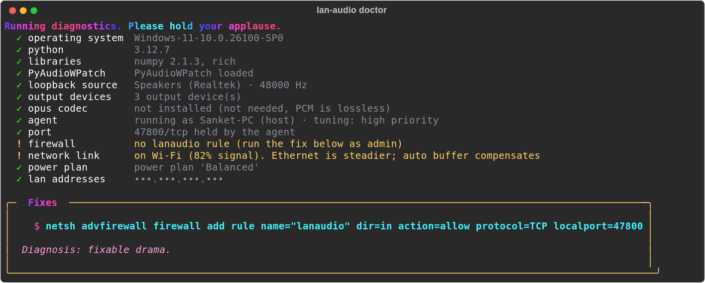

<p align="center">
  
</p>

<p align="center">
  <b>Stream everything playing on your PC, lossless and in sync, to everyone on your LAN.</b><br>
  A sassy, animated terminal app. No cloud, no accounts, no cables.
</p>

<p align="center">
  <a href="https://pypi.org/project/lanaudio/"></a>
  <a href="https://pypi.org/project/lanaudio/"></a>
  
  
  <a href="https://github.com/sohammmzzz/lan_audio/blob/main/LICENSE"></a>
</p>

---

## Table of contents

1. What is lan_audio?
2. Features
3. Screenshots
4. Requirements
5. Installation
6. Quick start (5 minutes)
7. How it works
8. Command reference: `serve`, `doctor`, `devices`, `status`, `ping`, `group`, `room`, `token`, `groups`, `join`, `leave`
9. Dashboard keyboard shortcuts
10. Reading the dashboards
11. Audio quality and the buffer
12. Network, firewall and ports
13. Configuration and environment variables
14. Troubleshooting
15. FAQ

---

## What is lan_audio?

**lan_audio** turns any Windows PC into a tiny radio station for your local network.
Whatever plays on the host (Spotify, YouTube, a game, a meeting) is captured straight from
the speakers, sent losslessly over your LAN, and played on every member's PC **at the same
moment**, with sync between members measured to within about a millisecond.

Every PC runs the same small agent, so any PC can host a room or join one. Members get a
one-time **pass (token)**. After setting it up once, they join with a single command:

```bash
lanaudio join office
```

## Features

| | |
|---|---|
| 🎧 **Lossless audio** | 24-bit PCM at the source's native sample rate (2.3 Mbps at 48 kHz). Float capture and playback end to end. |
| 🔗 **Persistent, self-healing stream** | One TCP connection per member. Nothing is dropped. If a link blinks, the member keeps playing from its buffer and the host replays what was missed. |
| ⏱️ **Synced playback** | Clock sync plus a slow drift-correcting resampler keep every member on the same sample. |
| 🛡️ **Auto buffer** | Starts at 500 ms and widens by itself if anyone's Wi-Fi gets shaky. Changes glide in without a click. |
| 🎟️ **Passes (tokens)** | Add someone to a group once, send them a token, and they join by group name forever. Remove them to revoke it. |
| 🚪 **Knock to join** | People without a pass can knock on the host's IP. The host sees a live **KNOCK KNOCK** panel and presses `A` or `D`. |
| 📻 **Multiple rooms** | Host several groups at once and stop one or all of them with one command. |
| 🔊 **Multi-device output** | Members can play on several headphones or speakers at once, with per-device delay for Bluetooth. |
| ✨ **A terminal with attitude** | Animated logo, ripples, spectrum bars, countdowns, confetti, red carpets, mic drops and plenty of sass. |
| 🩺 **Built-in doctor** | Checks audio, firewall, Wi-Fi and the power plan, and prints the exact fix commands. |

## Screenshots

### The agent (`lanaudio serve`)

<p align="center">
  
</p>

### Host dashboard (`lanaudio room start office`)

<p align="center">
  
</p>

### Listener dashboard (`lanaudio join office`)

<p align="center">
  
</p>

### Passes and groups

<p align="center">
  <br><br>
  
</p>

### Diagnostics (`lanaudio doctor`)

<p align="center">
  
</p>

## Requirements

| | |
|---|---|
| **OS** | Windows 10 or 11. Audio capture uses WASAPI loopback. |
| **Python** | 3.9 or newer |
| **Network** | All PCs on the same LAN. Ethernet is best; Wi-Fi works with the auto buffer. |
| **Version** | Every PC in a room must run the **same version** of lan_audio. |

Dependencies are installed automatically: `numpy`, `rich` and, on Windows, `PyAudioWPatch`.

## Installation

```bash
pip install lanaudio
```

Or, if you prefer an isolated install:

```bash
pipx install lanaudio
# or
uv tool install lanaudio
```

Optional Opus codec, only for very weak Wi-Fi (also needs `opus.dll` on your PATH):

```bash
pip install "lanaudio[opus]"
```

Check it worked:

```bash
lanaudio --version
lanaudio doctor
```

> Running from source instead? Use `python lanaudio.py <command>` wherever this guide says `lanaudio <command>`.

## Quick start (5 minutes)

In the commands below, replace `<host-ip>` with the host PC's LAN address and `<member-ip>` with
the member's. `lanaudio serve` shows a PC's address at the top of its screen.

### 1. Every PC: open the firewall and start the agent

Run this once in an **Administrator** Command Prompt:

```bat
netsh advfirewall firewall add rule name="lanaudio" dir=in action=allow protocol=TCP localport=47800
```

Then start the agent and **leave that terminal open**:

```bash
lanaudio serve --name "Sanket-PC"
```

Open a **new terminal** for everything below.

### 2. Host: create a group and add people

```bash
lanaudio group create office
lanaudio group add office <member-ip> --name Anuj
```

`group add` prints Anuj's **pass (token)** and copies the full setup command to your clipboard.
Paste it to Anuj on Teams or by email.

### 3. Member: set up the pass once

On Anuj's PC (with `lanaudio serve` running):

```bash
lanaudio token add LA1.xxxxxxxxxxxx...
```

### 4. Host: go live

```bash
lanaudio room start office
```

### 5. Member: join any time

```bash
lanaudio join office
```

That's it. If Anuj runs `join` before the room is live, his agent waits at the door and
joins automatically the moment it starts.

## How it works

```text
 HOST PC                                              MEMBER PC (one per listener)
 ┌──────────────────────────────┐                      ┌──────────────────────────────┐
 │ WASAPI loopback (float32)    │   one persistent     │ deep playout buffer          │
 │  → 20 ms frames, timestamped │   TCP connection     │  → clock-synced schedule     │
 │  → 24-bit PCM                │ ───────────────────► │  → drift-correcting resampler│
 │  → 3 s replay history        │  audio + control +   │  → 1..n output devices       │
 │ per-room member tracking     │  clock sync          │ keeps playing if link blinks │
 └──────────────────────────────┘                      └──────────────────────────────┘
```

1. The host captures the Windows default output and timestamps every 20 ms frame.
2. Each member holds one TCP connection to the host. TCP resends anything the network drops.
3. Members sync their clock to the host and play each frame at `timestamp + buffer`, so every PC plays the same sample at the same moment.
4. A slow, inaudible rate adjustment cancels out the tiny speed differences between sound cards.
5. If the connection drops, the buffer keeps the music going. On reconnect, the host sends exactly what was missed.

---

## Command reference

Commands are grouped by who usually runs them. **Host** commands run on the PC that plays the music.
**Member** commands run on listeners' PCs. Every command except `serve`, `doctor`, `devices`, `group` and
`token` needs the agent (`lanaudio serve`) running on the same PC.

Run `lanaudio` with no arguments for an animated command overview, or `lanaudio <command> --help` for details.

### Global options

These work with every command, before or after the command name.

| Option | Description |
|---|---|
| `--port PORT` | Agent port on this PC (default `47800`). The local control API uses `PORT-1`. Lets you run two agents on one PC for testing. |
| `--no-anim` | Plain output with no animations. Useful for scripts, logs and slow remote consoles. |
| `--version` | Show the version and exit. |
| `-h`, `--help` | Show help for any command. |

---

### `serve`

Start the agent. This is the background service that hosts rooms, receives audio and answers
the other commands. **Keep this terminal open.** Ctrl+C stops the agent and ends any room it hosts.

```bash
lanaudio serve [--name NAME]
```

| Option | Description |
|---|---|
| `--name NAME` | How you appear to others. Saved for next time. Defaults to the computer name. |

You get a looping animated screen with your address, mode (idle, ON AIR or listening), the
performance tuning that was applied, and a live activity feed.

---

### `doctor`

Check that this PC is ready, and print exact commands for anything that needs fixing.

```bash
lanaudio doctor
```

It checks the operating system, Python, libraries, PyAudioWPatch, the loopback source, output
devices, Opus, the agent, the port, the firewall rule, whether you're on Wi-Fi, the power plan and
your LAN addresses. It exits with code `1` if something is blocking.

---

### `devices`

List output devices, or choose which ones play the rooms you join.

```bash
lanaudio devices                 # list devices
lanaudio devices --set 1,3       # play rooms on devices 1 and 3
lanaudio devices --set all       # play on every device
lanaudio devices --set default   # back to the Windows default output
```

| Option | Description |
|---|---|
| `--set N,N \| all \| default` | Save which devices play rooms you join. Hands-free/headset call devices are hidden automatically. |

---

### `status`

Show what this agent is doing: name, address, uptime, tuning, the rooms it hosts (with buffer,
quality and knocking guests) or the room it is listening to (with gap count).

```bash
lanaudio status
```

---

### `ping`

Check that another PC's agent is reachable, and see its name, version, mode, live rooms and round-trip time.

```bash
lanaudio ping <host-ip>
lanaudio ping <host-ip>:47810
```

It warns you if the other PC runs a different version.

---

### `group` (host)

Manage groups and the people in them. Adding someone creates their personal pass.

```bash
lanaudio group create <group>
lanaudio group add <group> [<member-ip>] --name <who> [--host-ip <your-ip>]
lanaudio group token <group> <who> [--host-ip <your-ip>]
lanaudio group list [<group>]
lanaudio group remove <group> <who>
lanaudio group delete <group>
```

| Action | What it does |
|---|---|
| `create <group>` | Create a group. Names can't contain spaces or `@`. |
| `add <group> [<member-ip>] --name <who>` | Add someone and print their **token**. On Windows, the full `token add` command is copied to your clipboard. The IP is optional and for your reference only. |
| `token <group> <who>` | Show someone's token again (for example if they lost it). |
| `list [<group>]` | Show groups, their members and pass IDs. |
| `remove <group> <who>` | Remove someone by name or IP. Their token stops working immediately, and they're removed from the room if they're in it. |
| `delete <group>` | Delete the group and every pass for it. |

| Option | Description |
|---|---|
| `--host-ip <your-ip>` | The address members should use to reach **you**. Use it if your PC has VPN, Docker or WSL adapters and the auto-detected address is wrong. The choice is saved. |

```bash
lanaudio group create office
lanaudio group add office --name Anuj
lanaudio group add office --name Yashwanta --host-ip <your-ip>
lanaudio group token office Anuj
lanaudio group remove office Anuj
```

---

### `room` (host)

Host and control live rooms. A host can run one room per group, several at the same time.

```bash
lanaudio room start <group> [--latency auto|MS] [--codec pcm24|pcm16|opus] [--detach]
lanaudio room status
lanaudio room stop [<group>] [--all]
lanaudio room latency <MS|auto> [--group <group>]
lanaudio room kick <name> [--group <group>]
lanaudio room approve [<name>]
lanaudio room deny [<name>]
```

| Action | What it does |
|---|---|
| `start <group>` | Go live for a group: a 3-2-1 **ON AIR** countdown, then the live dashboard. Run it again with another group to host several rooms. |
| `status` | Open the live dashboard again (host or listener, whichever this PC is doing). |
| `stop <group>` | Stop one room. |
| `stop` (no group) or `stop --all` | Stop **all** rooms. |
| `latency <MS\|auto>` | Change the playout buffer. Members glide to the new value without a glitch. |
| `kick <name>` | Remove someone for the rest of this session. |
| `approve [<name>]` | Let a knocking guest in (the oldest one if no name is given). |
| `deny [<name>]` | Turn a knocking guest away. |

`room start` options:

| Option | Default | Description |
|---|---|---|
| `--latency auto\|MS` | `auto` | Playout buffer. `auto` starts at 500 ms and grows by 150 ms when anyone's headroom gets thin. A fixed value such as `300` stays put. Range 60–1500 ms. |
| `--codec` | `pcm24` | `pcm24`: lossless 24-bit (2.3 Mbps). `pcm16`: CD-quality lossless (1.5 Mbps). `opus`: 510 kbps, only for very weak Wi-Fi; needs `lanaudio[opus]` on every PC and a 48 kHz output. |
| `--detach` | off | Don't open the dashboard. The room keeps running in the agent. |

```bash
lanaudio room start office
lanaudio room start office --latency 300
lanaudio room start gaming --detach
lanaudio room latency auto
lanaudio room kick Rahul
lanaudio room stop office
lanaudio room stop
```

---

### `token` (member)

Set up the passes hosts send you. You only do this once per group.

```bash
lanaudio token add <TOKEN>
lanaudio token list
lanaudio token remove <group>[@<host>]
```

| Action | What it does |
|---|---|
| `add <TOKEN>` | Save a pass and check it with the host straight away. You can paste the whole line, including `lanaudio token add`. |
| `list` | Same as `lanaudio groups`. |
| `remove <group>[@<host>]` | Forget a pass. Add `@host` if two hosts use the same group name. |

> A token contains the host's address and a secret for one person. Share it only with the person it was made for.

---

### `groups` (member)

See every group you have a pass for, who hosts it, your name in it, whether it's **live right now**, and
the command to join it.

```bash
lanaudio groups
```

---

### `join` (member)

Join a room. Plays on your saved devices (see `devices`) and opens the listener dashboard.

```bash
lanaudio join <group>                    # with a pass
lanaudio join <group>@<host>             # if two hosts share a group name
lanaudio join <host-ip>[:port]           # no pass: knock, and the host lets you in
lanaudio join <host-ip> --group <g>      # knock on a specific room when the host runs several
```

| Option | Description |
|---|---|
| `--devices N,N \| all` | Output devices for this session only (numbers from `lanaudio devices`). |
| `--offset MS` or `--offset NAME=MS` | Delay all devices, or one device by name, to line up Bluetooth headphones. Repeatable, e.g. `--offset Realtek=180`. |
| `--volume 0.0–2.0` | Volume for this session (default 1.0). |
| `--group <g>` | With an IP: which of the host's rooms to knock on. |
| `--detach` | Don't open the dashboard. You stay connected in the background. |

If the room isn't live yet, your agent waits at the door and slides in the moment it starts.
If the connection drops, it reconnects by itself and the buffer covers the gap.

```bash
lanaudio join office
lanaudio join office --devices 1,2 --offset "BT Stereo=180"
lanaudio join <host-ip>
```

---

### `leave` (member)

Leave the room you're in.

```bash
lanaudio leave
```

---

## Dashboard keyboard shortcuts

**Host dashboard** (`room start` / `room status`)

| Key | Action |
|---|---|
| `A` | Let the knocking guest in |
| `D` | Turn the knocking guest away |
| `+` / `-` | Buffer up or down by 50 ms (switches to manual) |
| `U` | Back to auto buffer |
| `S` | Stop **all** rooms |
| `Q` | Detach. Rooms keep playing; reopen with `lanaudio room status`. |

**Listener dashboard** (`join` / `room status`)

| Key | Action |
|---|---|
| `L` | Leave the room |
| `Q` | Detach. You stay connected; reopen with `lanaudio room status`. |

## Reading the dashboards

| Column / field | Meaning | Healthy |
|---|---|---|
| **rtt** | Network round-trip time to the host | Under 5 ms wired, under 30 ms Wi-Fi |
| **headroom** | Smallest margin between a frame arriving and it being played, over the last 10 s | Green, above 150 ms. Below 70 ms, auto mode widens the buffer. |
| **gaps** | Times the speaker actually ran out of audio | **0** |
| **sync** | How far this member is from perfect time (corrected continuously) | Within ±5 ms |
| **buffer** | Audio waiting to be played, against the room's target | Bar mostly full |
| **↻ N** | Times the member reconnected without a gap | Any number is fine if gaps is 0 |

## Audio quality and the buffer

- **Quality:** the default `pcm24` codec is bit-exact 24-bit PCM at the host's output sample rate. There's no compression and no host-side resampling.
- **Delay:** members hear audio about one buffer (500 ms by default) after the host. That's the price of zero dropouts on Wi-Fi.
- **Lower delay:** on a wired network, try `lanaudio room latency 200`. Watch the **gaps** column. If it rises, go back to `auto`.
- **Bluetooth:** Bluetooth headphones add their own delay. Use `--offset` on the *other* devices to line them up.
- **Host's own speakers:** these play live, so they are ahead of the members by the buffer length. Mute them if you want everyone to hear exactly the same thing.

## Network, firewall and ports

| Port | Protocol | Purpose |
|---|---|---|
| `47800` | TCP, inbound | Everything between PCs: joins, audio, clock sync |
| `47799` | TCP, `localhost` only | Local control API used by the CLI. Never exposed to the network. |

Firewall rule (Administrator Command Prompt, on every PC):

```bat
netsh advfirewall firewall add rule name="lanaudio" dir=in action=allow protocol=TCP localport=47800
```

**Security**
- Passes are per person and per group. They're checked with an HMAC challenge, so the secret never crosses the network.
- Removing someone from a group revokes their pass at once.
- Guests without a pass must be approved by the host every session.
- Audio is not encrypted. Use lan_audio on networks you trust.

> On office networks, IT may block traffic between client PCs. If `lanaudio ping` fails while both agents are running, ask IT to allow TCP 47800 between the PCs.

## Configuration and environment variables

Settings live in a JSON file:

| OS | Path |
|---|---|
| Windows | `%APPDATA%\lanaudio\config.json` |
| Other | `~/.config/lanaudio/config.json` |

It holds your name, your groups and their passes (host), your saved passes (member), output devices, offsets and volume.

| Variable | Description |
|---|---|
| `LANAUDIO_PORT` | Default agent port (instead of `47800`). |
| `LANAUDIO_HOME` | Use a different config folder. Handy for running two agents on one PC. |
| `LANAUDIO_NO_ANIM` | Any value turns animations off, like `--no-anim`. |

## Troubleshooting

| Symptom | Fix |
|---|---|
| `Agent not running` | Run `lanaudio serve` in another terminal and keep it open. |
| `Port already taken` | An agent is already running. Use it, or pick another port with `--port`. |
| Member can't connect / `ping` gets no answer | Add the firewall rule on the **host**. Check both agents are running. Check `--host-ip` if the host has VPN/Docker/WSL adapters. Ask IT about TCP 47800. |
| `token revoked` | The host removed you. Ask them for a new pass. |
| `You don't have a token for 'office'` | Run `lanaudio token add <TOKEN>` first, or knock with `lanaudio join <host-ip>`. |
| Gaps keep rising | Use Ethernet. Set the Wi-Fi adapter's power saving to *Maximum Performance*. Avoid the *Power saver* plan. Or raise the buffer: `lanaudio room latency 800`. |
| Silence, but connected | Play something on the host. lan_audio captures the host's **Windows default output**; if you change it, stop and start the room. |
| One device is out of sync | Use `--offset NAME=MS` for that device when joining. |
| Versions differ | `lanaudio ping <host-ip>` shows both versions. Upgrade with `pip install -U lanaudio` on every PC. |
| Messy characters in old consoles | Use Windows Terminal, or add `--no-anim`. |

Run `lanaudio doctor` first. It finds most of these for you.

## FAQ

**Does it work on macOS or Linux?**
The CLI runs everywhere, but audio capture and playback need Windows (WASAPI loopback).

**How many listeners can a room have?**
Each listener uses about 2.3 Mbps with `pcm24`. On a wired gigabit LAN that's dozens. On Wi-Fi, keep it to roughly 10, or use `--codec opus` (510 kbps).

**Can I host and listen at the same time?**
No. One PC either hosts (any number of rooms) or listens to one room.

**Does the host hear the delay too?**
No. The host's speakers play live; only members are delayed by the buffer.

## License

MIT. See [LICENSE](https://github.com/sohammmzzz/lan_audio/blob/main/LICENSE).

<p align="center"><i>Lossless audio, flawless attitude.</i></p>
